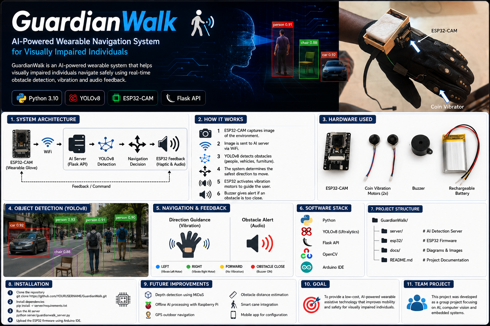

# 🧤 GuardianWalk
### AI-Powered Wearable Navigation System for Visually Impaired Individuals

<p align="center">
  
</p>

<p align="center">
  <strong>Empowering Independent Mobility Through Artificial Intelligence</strong>
</p>

<p align="center">
  An intelligent wearable assistive device integrating Artificial Intelligence, Computer Vision, and Embedded Systems to provide obstacle detection, directional navigation, and voice guidance for visually impaired individuals.
</p>

---

## 📖 01. Project Overview

**GuardianWalk** is an AI-powered wearable navigation system designed to improve the mobility, independence, and safety of visually impaired individuals.

The system uses an **ESP32-CAM** mounted on a wearable glove to capture images of the surrounding environment. These images are transmitted wirelessly to a **Python-based AI server**, where a **YOLOv8 object detection model** identifies nearby objects and obstacles.

Based on the detected objects and their relative positions, GuardianWalk provides navigation feedback through:

- 📳 **Dual Vibration Motors** – Left and right directional alerts.
- 🎧 **Bluetooth Voice Assistance** – Spoken navigation instructions.
- 📏 **Distance-Based Feedback** – Vibration intensity adjusts according to estimated obstacle distance.

By combining AI-powered object detection with wearable feedback mechanisms, GuardianWalk aims to make everyday navigation more accessible and convenient.

---

## 🎯 02. Project Objectives

The primary objective of GuardianWalk is to develop an affordable and intelligent wearable navigation device that assists visually impaired individuals.

The system aims to:

- Detect surrounding objects and potential obstacles.
- Identify the relative position of detected objects.
- Provide directional feedback through vibration motors.
- Deliver voice-based navigation instructions.
- Improve obstacle awareness through distance-based alerts.
- Develop a lightweight and portable assistive technology solution.

---

## ✨ 03. Key Features

| Feature | Description |
|---|---|
| 🧤 Wearable Design | Glove-based navigation system |
| 📷 Image Acquisition | ESP32-CAM environment monitoring |
| 🤖 AI Detection | YOLOv8 object detection |
| 📡 Wireless Communication | Wi-Fi-based image transmission |
| 📳 Directional Feedback | Dual coin vibration motors |
| 🎧 Voice Assistance | Bluetooth audio guidance |
| 📏 Distance Awareness | Distance-based vibration intensity |
| 🔋 Portable Design | Rechargeable battery-powered system |
| ♿ Accessibility | Designed for visually impaired individuals |

---

## 🧠 04. System Architecture

GuardianWalk follows a camera-to-server-to-controller architecture.

```text
                 ┌──────────────────┐
                 │     ESP32-CAM    │
                 │   Image Capture  │
                 └────────┬─────────┘
                          │
                          │ Wi-Fi
                          ▼
                 ┌──────────────────┐
                 │  Python AI Server│
                 │   Flask + YOLOv8 │
                 └────────┬─────────┘
                          │
                          ▼
                 ┌──────────────────┐
                 │ Object Detection │
                 │ Position Analysis│
                 │ Distance Estimate│
                 └────────┬─────────┘
                          │
                          ▼
                 ┌──────────────────┐
                 │ Navigation Logic │
                 └────────┬─────────┘
                          │
                          ▼
                 ┌──────────────────┐
                 │ ESP32 Controller │
                 └────────┬─────────┘
                          │
                ┌─────────┴─────────┐
                │                   │
                ▼                   ▼
         ┌─────────────┐    ┌─────────────┐
         │ Left Motor  │    │ Right Motor │
         │  Vibration  │    │  Vibration  │
         └─────────────┘    └─────────────┘
                │                   │
                └─────────┬─────────┘
                          │
                          ▼
                 ┌──────────────────┐
                 │ Bluetooth Voice  │
                 │     Guidance     │
                 └──────────────────┘
```

---

## ⚙️ 05. Working Principle

The GuardianWalk system operates through the following sequence:

1. **Image Capture:** The ESP32-CAM continuously captures images of the user's surroundings.
2. **Wireless Transmission:** Captured images are transmitted to the Python AI server through Wi-Fi.
3. **Object Detection:** The server processes the images using the YOLOv8 object detection model.
4. **Position Analysis:** Detected objects are analyzed according to their relative positions within the image.
5. **Distance Assessment:** The system estimates the distance of detected obstacles.
6. **Navigation Decision:** The navigation logic determines the appropriate directional warning.
7. **Feedback Generation:** Commands are transmitted to the ESP32 controller.
8. **User Assistance:** Vibration motors and Bluetooth voice guidance provide navigation feedback.

---

## 📳 06. Navigation Feedback System

GuardianWalk uses two vibration motors to communicate directional warnings.

### ◀️ Left-Side Obstacle

- Left vibration motor activates.
- Bluetooth voice announces the obstacle on the left.
- Vibration intensity increases as the obstacle gets closer.

### ▶️ Right-Side Obstacle

- Right vibration motor activates.
- Bluetooth voice announces the obstacle on the right.
- Stronger vibration indicates reduced distance.

### ⚠️ Obstacle Directly Ahead

- Both vibration motors activate simultaneously.
- Bluetooth provides an immediate warning.
- Continuous strong vibration indicates a potentially critical obstacle.

### ✅ Clear Path

- No vibration warning.
- Bluetooth may provide navigation instructions or indicate that the path is clear.

---

## 📏 07. Distance-Based Feedback

The system adjusts vibration intensity according to the estimated distance of detected obstacles.

| Estimated Distance | Feedback Response |
|---|---|
| Greater than 2 m | No vibration or light pulse |
| 1–2 m | Medium vibration |
| Less than 1 m | Strong vibration |
| Very Close | Continuous strong vibration and immediate voice warning |

This feedback mechanism helps users understand the approximate proximity of obstacles through tactile alerts.

---

## 🎯 08. AI Object Detection Capabilities

GuardianWalk uses YOLOv8 to identify objects in the surrounding environment.

### Supported Detection Categories

- 🚶 Person
- 🚗 Car
- 🚌 Bus
- 🏍 Motorcycle
- 🚲 Bicycle
- 🪑 Chair
- 🛋 Sofa
- 🌳 Tree
- 🐕 Animals
- 🚪 Door
- 🪜 Stairs
- 🧱 Wall
- 📦 Box
- 🪧 Signboard
- 🛒 Shopping Cart

**Note:** Actual detection categories depend on the YOLOv8 model and its training dataset. Additional classes may require a custom-trained model.

---

## 🔧 09. Hardware Components

| Component | Function |
|---|---|
| ESP32-CAM | Captures surrounding images |
| Left Coin Vibration Motor | Left-side obstacle indication |
| Right Coin Vibration Motor | Right-side obstacle indication |
| Bluetooth Audio Module | Voice navigation assistance |
| Rechargeable Lithium-ion Battery | Portable power supply |
| Wearable Glove | Hardware mounting |
| Connecting Wires | Electrical connections |

---

## 💻 10. Software & Technologies

| Technology | Application |
|---|---|
| Python | AI processing and backend development |
| YOLOv8 | Object detection |
| OpenCV | Image processing |
| Flask | API communication |
| Arduino IDE | ESP32 firmware development |
| Wi-Fi | Wireless communication |
| Git | Version control |
| GitHub | Source code management |

---

## 🚀 11. Installation & Setup

### Step 1. Clone the Repository

```bash
git clone https://github.com/joshua14134/GuardianWalk.git

cd GuardianWalk
```

### Step 2. Install Python Dependencies

```bash
pip install -r server/requirements.txt
```

### Step 3. Start the AI Server

```bash
python server/guardianwalk_server.py
```

### Step 4. Upload ESP32 Firmware

1. Open Arduino IDE.
2. Open the `esp32` directory.
3. Select the appropriate ESP32-CAM board.
4. Configure the Wi-Fi credentials.
5. Upload the firmware.
6. Connect the ESP32-CAM to the same Wi-Fi network as the AI server.

### Step 5. Run GuardianWalk

Once the server and ESP32-CAM are connected, the system can begin capturing images, detecting objects, and providing navigation feedback.

---

## 🔄 12. Complete System Workflow

```text
       ESP32-CAM
            │
            ▼
       Image Capture
            │
            ▼
     Wi-Fi Transmission
            │
            ▼
     Python Flask Server
            │
            ▼
      YOLOv8 Detection
            │
            ▼
      Position Analysis
            │
            ▼
      Distance Estimation
            │
            ▼
    Navigation Decision
            │
            ▼
      ESP32 Controller
            │
       ┌────┴─────┐
       │          │
       ▼          ▼
  Left Motor  Right Motor
       │          │
       └────┬─────┘
            │
            ▼
    Bluetooth Voice Output
```

---

## 📸 13. Project Demonstration

<p align="center">
  <video width="85%" controls>
    <source src="./project_demo.mp4" type="video/mp4">
    Your browser does not support video playback.
  </video>
</p>

The demonstration showcases the GuardianWalk wearable glove prototype, ESP32-CAM integration, AI-powered object detection, directional navigation, and Bluetooth voice guidance.

---

## 💡 14. Applications

- ♿ Smart Assistive Technology
- 🧤 Wearable AI Devices
- 🚶 Navigation Assistance
- 🏥 Healthcare Technology
- 🤖 Embedded AI Systems
- 👁 Computer Vision Research
- 📡 IoT Applications
- 🌍 Accessibility Solutions

---

## 🚀 15. Future Enhancements

Potential enhancements for future versions include:

- 📏 Advanced monocular depth estimation.
- 🗺 GPS-assisted outdoor navigation.
- 📱 Android companion application.
- ☁ Cloud synchronization.
- 🧠 Edge AI processing using Raspberry Pi.
- 🎙 Advanced voice assistant.
- 🔋 Improved battery efficiency.
- 🦯 Smart cane integration.
- 🌍 Offline object detection.

---

## 📚 16. Learning Outcomes

The development of GuardianWalk provided practical experience in:

- Artificial Intelligence and Deep Learning
- Computer Vision and Object Detection
- Embedded Systems Development
- ESP32-CAM Programming
- OpenCV Image Processing
- Flask API Development
- Python Programming
- IoT Communication
- Wearable Computing
- Human-Centered Assistive Technology

---

## 👥 17. Team Project

GuardianWalk was developed as a collaborative academic project focused on designing an affordable AI-powered wearable navigation system for visually impaired individuals.

The project integrates Artificial Intelligence, Embedded Systems, IoT, and Computer Vision to deliver obstacle detection and intuitive navigation assistance.

---

## 👨‍💻 18. Developer

**Joshua Greg Colaco**

- **GitHub:** [joshua14134](https://github.com/joshua14134)

---

## 📄 19. License

This project is licensed under the **MIT License**.

---

<p align="center">
  ❤️ Built to improve accessibility through Artificial Intelligence and Assistive Technology.
</p>

<p align="center">
  ⭐ If you found this project useful, consider giving it a star on GitHub.
</p>
